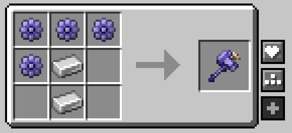
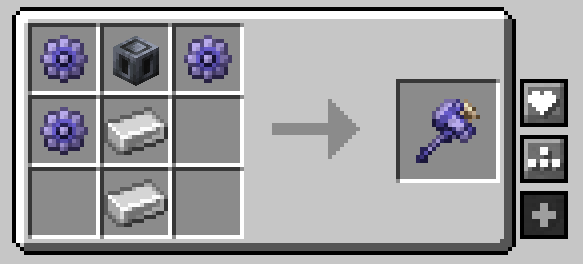

# 🔨 Tinkhammer Redux

This datapack (and resource pack) changes a few things for the _Tinkhammer_ from the [CobbleSafari mod](https://modrinth.com/mod/cobblesafari).

The datapack is available on Modrinth! Download it here: *Pending approval*

## ✨ Features

### Retextures
- Enhanced textures for Tinkhammer, Tinkagear, and the Tinkagear Block

### Tinkhammer Additions
- A _slightly_ tweaked crafting recipe that depends on which version you install.

  
Default

  
  

  
Heavy Core Edition

  

- Added pickaxe properties to the Tinkhammer (based on diamond-tier) so it no longer behaves like an axe
- Can be enchanted with the following enchants (exclusivity rules still apply):
  - Mending
  - Unbreaking
  - Curse of Vanishing
  - Efficiency
  - Fortune
  - Silk Touch
  - Smite
  - Bane of Arthropods
- Added compat for modded enchantments:
  - Obsidian Breaker from _Better Nether / BetterNether New Dawn_
  - Soulbound from _You're in Grave Danger_
  - Critical Impact and Critical Hit from _Critical Strike_
- Can break pots and be able to harvest crystal clusters (amethyst and tumblestones)
- When _the Aether_ is installed: You can hit the Slider boss with the hammer!

## 🔧 Support

- Both NeoForge and Fabric!
- `Cobblemon: 1.7.3+`
- `Cobblesafari: 0.3.0+` (tested on `0.3.5`, but should behave the same way in previous versions)

## 📖 Credits
- [maxigregrze](https://modrinth.com/user/maxigregrze): CobbleSafari developer and creator of the base textures that were enhanced
